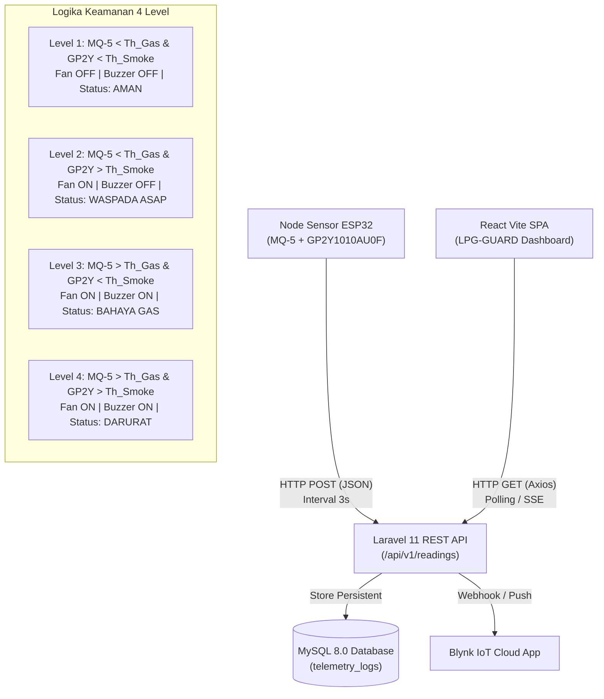

# Master Plan & Arsitektur Implementasi Dashboard Monitoring Kebocoran Gas LPG & Kualitas Udara (ITERA IoT System)

Dokumen ini merupakan panduan teknis lengkap, rencana kerja modular, dan milestone bertahap untuk membangun antarmuka web monitoring sistem deteksi kebocoran gas LPG dan partikulat asap berbasis **React 18 + Vite (SPA)**, **Laravel 11 REST API**, dan **MySQL 8.0**, sesuai dengan spesifikasi naskah Proposal Tugas Akhir ITERA.

---

## 1. Ringkasan Eksekutif & Karakteristik Antarmuka

Berdasarkan rancangan antarmuka *LPG-GUARD (ITERA IoT System)*, dashboard web mengusung pendekatan Single Page Application (SPA) berkinerja tinggi dengan prinsip *Anti-Slop UI*:
- **Tipografi Bersih & Takik Taktil**: Menggunakan font sans-serif modern (Inter / Plus Jakarta Sans), hirarki visual tegas tanpa elemen dekoratif berlebihan.
- **Palet Warna Status Dinamis**:
  - Hijau Muted (`#10b981` / Emerald) : Level 1 - Status Aman (Normal)
  - Oranye/Kuning Amber (`#f59e0b`) : Level 2 - Waspada Asap Dapur Tinggi
  - Merah Terang (`#ef4444` / Crimson) : Level 3 - Bahaya Gas LPG & Level 4 - Darurat Gas + Asap
- **Refresh Asinkron Ringan**: Polling terstruktur menggunakan Axios atau Server-Sent Events / Webhook dengan interval 3 detik, mencegah kedip atau full-page reload.

---

## 2. Diagram Alur Data & Logika Sistem 4 Level



---

## 3. Spesifikasi Komponen Tampilan (Berdasarkan Wireframe Realistis)

### 3.1 Bagian Sidebar Kiri (Navigation & Hardware Status)
1. **Header Brand**:
   - Judul: `LPG-GUARD`
   - Subjudul: `ITERA IoT System`
2. **Menu Navigasi Utama**:
   - `Dashboard Real-time` (Active State dengan background solid biru `#2563eb`)
   - `Grafik & Tren Sensor`
   - `Log Histori & Audit`
   - `Kontrol Aktuator Manual`
   - `Ambang Batas (Threshold)`
   - `Pengaturan Perangkat`
3. **Widget Device Status (Bawah)**:
   - Node ID: `ESP32_LPG_01`
   - Alamat IP: `192.168.1.105`
   - Latensi Jaringan: `Ping: 18 ms (Online)`

### 3.2 Bagian Header Atas (Top Bar)
1. **Title Banner**:
   - `Dashboard Pemantauan Kebocoran Gas LPG & Kualitas Udara`
   - Subtitle: `Laboratorium Teknik Telekomunikasi ITERA | Pembaruan Otomatis: Setiap 3 Detik`
2. **Badges Kanan**:
   - Tech Badge: `React 18 + Vite | Laravel 11 API`
   - Watchdog Indicator: Bulatan hijau berdenyut halus + Teks `SISTEM AKTIF (ONLINE)`

### 3.3 Kartu Metrik Ringkasan (5 Parameter Cards)
1. **Konsentrasi Gas LPG**:
   - Nilai: `385 ppm`
   - Sumber: Sensor MQ-5 (Ambang Batas: `800 ppm`)
2. **Kepekatan Partikel**:
   - Nilai: `24.8 ug/m3`
   - Sumber: Sensor GP2Y1010AU0F (Ambang Batas: `150 ug/m3`)
3. **Kipas Exhaust (Relay)**:
   - Nilai: `OFF` (Modul Relay 5V - Kipas Standby / Mati)
4. **Alarm Buzzer 5V**:
   - Nilai: `OFF` (Piezo Buzzer Aktif - Kondisi Hening / Normal)
5. **Tingkat Keamanan**:
   - Nilai: `LEVEL 1`
   - Status: `STATUS: AMAN (NORMAL)` (Dynamic badge berganti warna sesuai level 1-4)

### 3.4 Area Visualisasi Utama (Bento Grid 60/40)
1. **Grafik Tren Fluktuasi Real-time (Kiri - 60% Lebar)**:
   - Pustaka: `react-chartjs-2` + `chart.js`
   - Seri Data:
     - Garis Merah Solid: Konsentrasi Gas MQ-5 (PPM)
     - Garis Biru Putus-putus: Kepekatan Asap GP2Y1010AU0F (ug/m3)
   - Rentang Waktu (Filter Bar): `1 Menit` (Active), `5 Menit`, `15 Menit`, `1 Jam`, `Unduh CSV`
2. **Tabel Log Histori & Audit Trail (Kanan - 40% Lebar)**:
   - Judul & Subtitle: `Log Histori & Audit Trail (MySQL)` | `Endpoint: /api/v1/readings`
   - Kolom: `WAKTU`, `MQ-5`, `GP2Y`, `FAN/BUZ`, `STATUS`
   - Baris: 8 record data telemetri terkini dengan badge status terwarnai.
   - Footer: Keterangan `Menampilkan 8 dari 1.240 data rekaman` + Tombol `Lihat Semua ->`

---

## 4. Struktur Database & Schema MySQL

```sql
CREATE DATABASE IF NOT EXISTS lpg_monitoring_db;
USE lpg_monitoring_db;

CREATE TABLE IF NOT EXISTS telemetry_logs (
    id BIGINT UNSIGNED AUTO_INCREMENT PRIMARY KEY,
    device_id VARCHAR(50) NOT NULL DEFAULT 'ESP32_LPG_01',
    mq5_raw INT NOT NULL,
    mq5_ppm FLOAT NOT NULL,
    gp2y_voltage FLOAT NOT NULL,
    gp2y_dust_density FLOAT NOT NULL,
    fan_status ENUM('ON', 'OFF') NOT NULL DEFAULT 'OFF',
    buzzer_status ENUM('ON', 'OFF') NOT NULL DEFAULT 'OFF',
    security_level TINYINT UNSIGNED NOT NULL,
    security_status VARCHAR(50) NOT NULL,
    blynk_synced BOOLEAN DEFAULT TRUE,
    created_at TIMESTAMP DEFAULT CURRENT_TIMESTAMP,
    INDEX idx_device_time (device_id, created_at)
) ENGINE=InnoDB DEFAULT CHARSET=utf8mb4 COLLATE=utf8mb4_unicode_ci;

CREATE TABLE IF NOT EXISTS system_thresholds (
    id INT AUTO_INCREMENT PRIMARY KEY,
    gas_threshold_ppm FLOAT NOT NULL DEFAULT 800.0,
    dust_threshold_ug FLOAT NOT NULL DEFAULT 150.0,
    updated_at TIMESTAMP DEFAULT CURRENT_TIMESTAMP ON UPDATE CURRENT_TIMESTAMP
);
```

---

## 5. Rencana Kerja Modular & Milestone Pengembangan

```
Dashboard Implementation Roadmap
├── Milestone 1: Arsitektur Backend & Database (Laravel 11 + MySQL)
├── Milestone 2: Setup Frontend React + Vite + Tailwind CSS
├── Milestone 3: Komponen Antarmuka Statis & Anti-Slop UI Styling
├── Milestone 4: Integrasi Data Real-Time (Axios Polling / WebSocket) & Chart.js
├── Milestone 5: Logika Klasifikasi 4-Level & Integrasi Notifikasi
└── Milestone 6: Pengujian Black-Box, Evaluasi Latensi, & Final Deployment
```

### Milestone 1: Setup Backend REST API & Database (Estimasi: 3 Hari)
- [ ] Inisialisasi proyek Laravel 11 (`composer create-project laravel/laravel backend-api`).
- [ ] Konfigurasi file `.env` untuk koneksi MySQL database `lpg_monitoring_db`.
- [ ] Pembuatan migrasi skema tabel `telemetry_logs` dan `system_thresholds`.
- [ ] Pembuatan Model `TelemetryLog` dengan casting tipe data terproteksi.
- [ ] Implementasi `TelemetryController`:
  - `POST /api/v1/telemetry`: Endpoint ingest payload JSON dari mikrokontroler ESP32 dengan validasi input ketat (mencegah SQL Injection).
  - `GET /api/v1/telemetry/latest`: Mengambil status paling mutakhir untuk 5 metrik kartu.
  - `GET /api/v1/telemetry/history`: Mengambil riwayat log terpaginate (default: 8 data untuk widget audit trail).
  - `GET /api/v1/telemetry/chart?range=1m`: Mengambil array deret waktu untuk grafik tren sensor.
- [ ] Uji coba endpoint menggunakan tools pengujian API (cURL / Postman).

### Milestone 2: Setup Frontend React 18 + Vite (Estimasi: 2 Hari)
- [ ] Inisialisasi React Vite (`npm create vite@latest frontend -- --template react`).
- [ ] Instalasi dependensi:
  - `lucide-react` (icon vector murni, anti-emoji).
  - `chart.js` & `react-chartjs-2` (visualisasi deret waktu performa tinggi).
  - `axios` (klien HTTP asinkron).
  - `tailwindcss` & `postcss` (sistem styling utility presisi).
- [ ] Konfigurasi Tailwind CSS untuk tema warna netral, slate border hairline, dan palet status (Emerald, Amber, Crimson).
- [ ] Konfigurasi alias path `@/components`, `@/services`, `@/hooks`.

### Milestone 3: Implementasi Komponen UI & Layouting (Estimasi: 4 Hari)
- [ ] **Komponen Layout**:
  - `Sidebar.jsx`: Navigasi samping dengan state aktif, logo ITERA, dan device status pill.
  - `TopHeader.jsx`: Banner judul instrumen dan online status watchdog.
- [ ] **Komponen Metrik Ringkasan**:
  - `MetricCardsGrid.jsx`: Kontainer 5 kartu metrik dengan visual border taktil `border-slate-200`.
  - `MetricCard.jsx`: Kartu individual dengan label, nilai berukuran besar (bold), unit satuan, dan status ambang batas.
- [ ] **Komponen Visualisasi Utama**:
  - `RealtimeChart.jsx`: Canvas grafik garis ganda dengan smoothing kurva Catmull-Rom/Monotone, gridline tipis, dan filter bar rentang waktu.
  - `AuditLogTable.jsx`: Tabel histori data dengan baris bergantian, format timestamp, dan chip status level 1-4.
- [ ] **Penyelarasan Desain**:
  - Memastikan tampilan identik dengan mockup wireframe (rasio 60/40, margin presisi, zero layout shift).

### Milestone 4: Integrasi Data Real-Time & State Management (Estimasi: 3 Hari)
- [ ] Pembuatan custom hook `useTelemetryData(refreshInterval = 3000)`:
  - Menjalankan fetch berkala ke `/api/v1/telemetry/latest` dan `/api/v1/telemetry/chart`.
  - Mengelola status koneksi watchdog: jika respons terhenti >10 detik, ubah badge menjadi `DELAYED`, dan jika >30 detik menjadi `OFFLINE`.
- [ ] Integrasi data sensor ke Chart.js dengan mode pembaruan buffer tanpa merender ulang seluruh komponen.
- [ ] Integrasi fitur ekspor data log ke format `.csv`.

### Milestone 5: Integrasi Kontrol Aktuator & Sinkronisasi Blynk (Estimasi: 3 Hari)
- [ ] Endpoint kontrol manual kipas dan buzzer (`POST /api/v1/actuator/control`).
- [ ] Penanganan transisi dinamis kartu level keamanan (Level 1 Aman -> Level 2 Waspada Asap -> Level 3 Bahaya Gas -> Level 4 Darurat).
- [ ] Sinkronisasi data ke webhook platform Blynk IoT untuk notifikasi sekunder ke smartphone pengguna.

### Milestone 6: Pengujian Black-Box, Latensi & Finalisasi (Estimasi: 3 Hari)
- [ ] Pengujian fungsionalitas kotak hitam (Black-Box Testing) pada seluruh navigasi dan filter.
- [ ] Pengujian performa Packet Delivery Ratio (PDR) dan konsistensi data antara database MySQL dengan tampilan React.
- [ ] Pengukuran latensi end-to-end ($T_{\text{latensi}} = T_{\text{tampil}} - T_{\text{kirim}}$) agar tetap berada di bawah 2 detik.
- [ ] Dokumentasi panduan operasional server lokal (XAMPP/Docker) dan panduan *build* produksi (`npm run build`).

---

## 6. Petunjuk Menjalankan Prototipe Secara Lokal

### Kebutuhan Sistem:
- PHP >= 8.2 & Composer
- Node.js >= 18.x & npm
- MySQL Server >= 8.0

### Langkah Instalasi Cepat:
```bash
# 1. Kloning / Buka folder proyek
cd "c:\Users\j\Documents\Dokumen\Draft\Tugas Akhir Tiara Permata\DASHBOARD SISTEM DETEKSI KEBOCORAN GAS LPG"

# 2. Setup Backend (Laravel)
cd backend
composer install
cp .env.example .env
php artisan key:generate
php artisan migrate --seed
php artisan serve --port=8000

# 3. Setup Frontend (React Vite)
cd ../frontend
npm install
npm run dev -- --port=3000
```
Dashboard akan siap diakses melalui peramban web pada URL `http://localhost:3000`.
